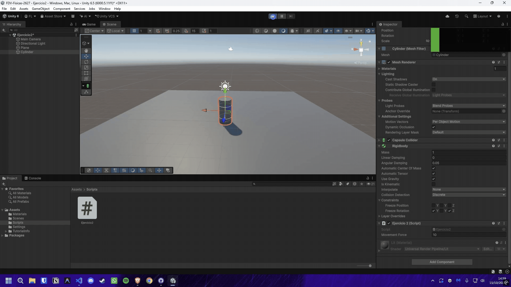
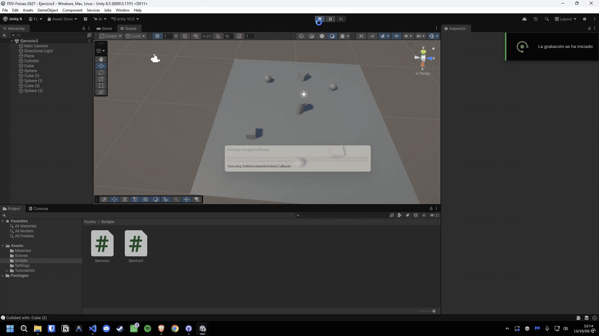
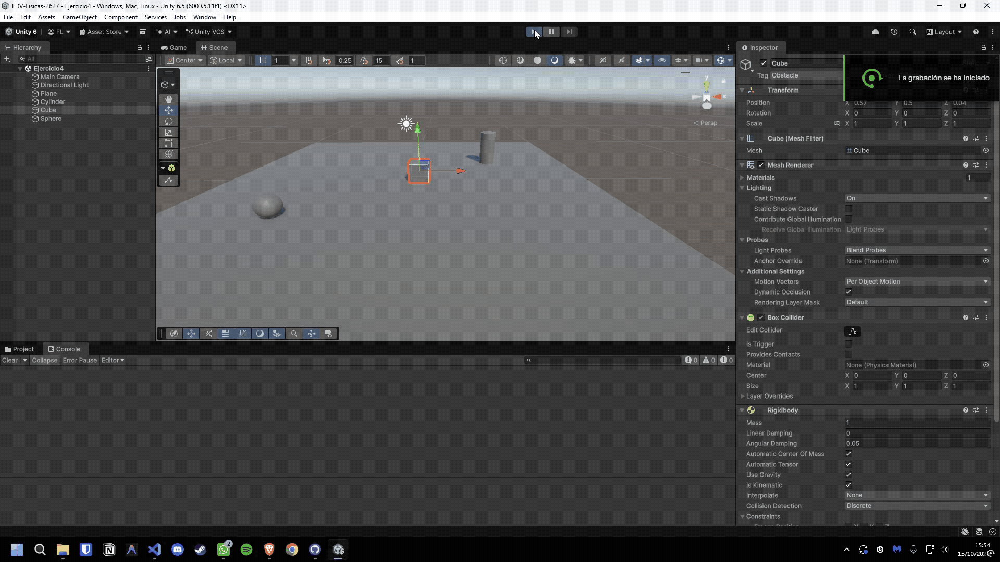

# FDV-Fisicas-2627

## Ejercicio 1

El ejercicio consiste en experimentar con diferentes configuraciones de los components Rigidbody y Collider y explicar los resultados obtenidos en base a lo explicado en clase. Para ello vamos a configurar una escena con 3 objetos: Plano, Cubo y Esfera.

### Situación 1

***El plano no es un objeto físico. El cubo es un objeto físico y la esfera no. En este caso, el plano y la esfera sólo tendrán collider, mientras que el cubo debe tener Rigidbody.***

El cubo se posa sobre el plano, que se queda inmóvil, mientras que la esfera se encuentra inmóvil flotando en el aire.

### Situación 2

***El plano no es un objeto físico. El cubo es un objeto físico y la esfera también. En este caso, el plano sólo tendrán collider, mientras que el cubo y la esfera deben tener Rigidbody.***

El cubo se posa sobre el plano, que se queda inmóvil, mientras que la esfera cae sobre el cubo y rebota, rodando por el plano hasta caer al vacío.

### Situación 3

***El plano no es un objeto físico. El cubo es un objeto físico y la esfera es cinemática. En este caso, el plano sólo tendrán collider, mientras que el cubo y la esfera deben tener Rigidbody esta última cinemático.***

El cubo se posa sobre el plano, que se queda inmóvil, mientras que la esfera se mantiene inmóvil flotando en el aire, es un objeto físico, pero al ser cinemática no reacciona a la gravedad ni a las colisiones.

### Situación 4

***El plano es un objeto físico. El cubo es un objeto físico y la esfera es física. En este caso, todos los objetos deben tener Rigidbody.***

Todos los objetos caen al vacío, incluyendo el plano, que al ser un objeto físico también reacciona a la gravedad y cae.

### Situación 5

***El plano es un objeto físico. El cubo es un objeto físico y la esfera es física con 10 veces más masa que el cubo. En este caso, todos los objetos deben tener Rigidbody.***

Igual que el caso anterior, todos los objetos caen al vacío con la misma aceleración, debido a que caen en el vacío y no hay fricción, la masa de la esfera resulta irrelevante. Pero si el plano fuese estático, la esfera caería sobre el cubo y lo golpearía con más fuerza que en la situación 4.

### Situación 6

***El plano es un objeto físico. El cubo es un objeto físico y la esfera es física con 100 veces más masa que el cubo. En este caso, todos los objetos deben tener Rigidbody.***

Ocurre lo mismo que en la situación 5, todos los objetos caen al vacío con la misma aceleración, debido a que caen en el vacío y no hay fricción, la masa de la esfera resulta irrelevante. Pero si el plano fuese estático, la esfera caería sobre el cubo y lo golpearía con mucha más fuerza.

### Situación 7

***El plano es un objeto físico. El cubo es un objeto físico y la esfera es física con fricción. En este caso, todos los objetos deben tener Rigidbody.***

Todos los objetos caen al vacío con la misma aceleración, debido a que caen en el vacío y no hay fricción, la fricción de la esfera resulta irrelevante. Si la esfera rodase por el plano, rodaría a menor velocidad y tardaría más en caer al vacío, incluso puede que no llegase al borde del plano.

### Situación 8

***El plano es un objeto físico. El cubo es un objeto físico y la esfera no es física y es Trigger. En este caso, todos los objetos deben tener Rigidbody.***

La esfera no interactúa con el resto de los objetos, ya que es un Trigger. Cualquier objeto que colisionase con la esfera la atravesaría, ya que carece de colisión física, pero se podría activar un evento como `OnTriggerEnter`.

### Situación 9

***El plano es un objeto físico. El cubo es un objeto físico y la esfera es física y es Trigger. En este caso, todos los objetos deben tener Rigidbody.***

Siendo un objeto Trigger y teniendo físicas, respondería a las reglas físicas como la gravedad, pero en el caso de colisionar con algún objeto, simplemente lo atravesaría, ya que no tiene colisión física.

## Ejercicio 2

***Crea un controlador con las flechas arriba-abajo, derecha-izquierda que controle al cilindro con físicas.***

Para este ejercicio se creó un script encargado del movimiento del cilindro, el cual permite el movimiento con las flechas del teclado. Este es el código del script:

```csharp
public class Ejercicio2 : MonoBehaviour
{
    [SerializeField] private float movementForce = 10f;

    private Rigidbody rb;
    private Vector3 movementDirection;

    private void Awake()
    {
        rb = GetComponent<Rigidbody>();
    }

    private void Update()
    {
        movementDirection = Vector3.zero;

        if (Input.GetKey(KeyCode.LeftArrow))  movementDirection += Vector3.left;
        if (Input.GetKey(KeyCode.RightArrow)) movementDirection += Vector3.right;
        if (Input.GetKey(KeyCode.UpArrow))    movementDirection += Vector3.forward;
        if (Input.GetKey(KeyCode.DownArrow))  movementDirection += Vector3.back;

        movementDirection = movementDirection.normalized;
    }

    private void FixedUpdate()
    {
        rb.AddForce(movementDirection * movementForce, ForceMode.Force);
    }
}
```



## Ejercicio 3

***Crea varios cubos o esferas con Rigidbody dinámico. Muestra por consola el nombre del objeto con el que colisiona, y cámbiale su color al colisionar.***

Para este ejercicio simplemente se modificó el script existente del ejercicio 2, agregando el método `OnCollisionEnter` que imprime el nombre del objeto con el que colisiona el cilindro. Este es el código modificado:

```csharp
    private void OnCollisionEnter(Collision collision)
    {
        Debug.Log($"Collided with: {collision.gameObject.name}");
    }
```

Para el cubo y la esfera se les creó un script que hace que cambien de color cada vez que entran en colisión con otro objeto. Este es el código del script:

```csharp
public class Ejercicio3 : MonoBehaviour
{
    private Renderer renderer;

    private void Awake()
    {
        renderer = GetComponent<Renderer>();
    }

    private void OnCollisionEnter(Collision collision)
    {
        renderer.material.color = Random.ColorHSV();
    }
}
```



## Ejercicio 4

***En la escena debe haber 3. Un cubo y un cilindro cinemáticos, una esfera con collider y Rigidbody. Marcar el cilindro como objetivo a alcanzar por la esfera. El cubo debe hacer de obstáculo entre ambos. Implementar un script que haga que la esfera se dirija al cilindro, cuando la esfera alcance el cubo, este debe cambiar su material y el cubo avanzar hacia adelante.***

Para este ejercicio, se configuró la escena como se indica y se crearon dos scripts:

En el primero, se le dice a la esfera que debe seguir al cilindro, que se mantiene estático en la escena debido a que es un objeto cinemático. En el caso de que esta colisione con el cubo (que tiene asignada la etiqueta "Obstacle"), debe cambiar el color de su material. Este es el código del script:

```csharp
public class Ejercicio4 : MonoBehaviour
{
    [SerializeField] private GameObject Cylinder;
    [SerializeField] private float movementForce = 10f;
    private Rigidbody rb;
    private Renderer renderer;

    private void Awake()
    {
        rb = GetComponent<Rigidbody>();
        renderer = GetComponent<Renderer>();
    }

    private void FixedUpdate()
    {
        if (Cylinder == null || rb == null)
        {
            return;
        }

        Vector3 direction = Cylinder.transform.position - transform.position;
        rb.AddForce(direction.normalized * movementForce, ForceMode.Force);
    }

    private void OnCollisionEnter(Collision collision)
    {
        if (collision.gameObject.CompareTag("Obstacle"))
        {
            Debug.Log("Collided with an obstacle!");
            renderer.material.color = Random.ColorHSV();
        }
    }
}
```

En el segundo script, se le dice al cubo que debe avanzar hacia adelante (en su vector forward)cuando colisione con la esfera. Este es el código del script:

```csharp
[RequireComponent(typeof(Rigidbody))]
public class Ejercicio4_Cube : MonoBehaviour
{
    [SerializeField] private float movementSpeed = 10f;
    private Rigidbody rb;
    private bool isMoving;

    private void Awake()
    {
        rb = GetComponent<Rigidbody>();
    }

    private void FixedUpdate()
    {
        if (!isMoving) return;

        rb.MovePosition(rb.position + transform.forward * movementSpeed * Time.fixedDeltaTime);
    }

    private void OnCollisionEnter(Collision collision)
    {
        if (collision.gameObject.CompareTag("Sphere"))
        {
            Debug.Log("Collided with the Sphere!");
            isMoving = true;
        }
    }
}
```

